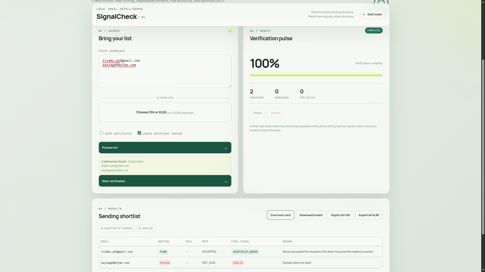

# 📬 SignalCheck — Free & Open Source Bulk Email Verifier

[](LICENSE)
[](https://www.python.org/)
[](https://flask.palletsprojects.com/)
[](tests/)
[](https://github.com/)

**SignalCheck** is a free, privacy-first, local bulk email verification engine and web application. It helps you clean mailing lists, reduce bounce rates, and identify deliverable email candidates **without relying on expensive third-party APIs or sending your data to external servers**.

Built and maintained by **Abu Bakar / Itsabu Works**: [itsabu.pk](https://www.itsabu.pk/).

---

<p align="center">
  
</p>

---

## 🌟 Why SignalCheck?

Most email verification services charge expensive monthly subscriptions and require you to upload your confidential customer contacts to third-party clouds.

SignalCheck runs **100% locally on your computer**:
* **Zero Cost**: Completely free and open-source under the MIT license.
* **Complete Privacy**: Your lists never leave your computer.
* **Honest Signals**: No marketing gimmicks or fake claims. If a server is ambiguous, it tells you clearly.

---

## ⚡ Core Features

- **Multi-Stage Verification Pipeline**:
  - 🔍 **Syntax & Format Validation**: RFC 5322 & RFC 5890 compliance check powered by `email-validator`.
  - 🌐 **DNS & MX Routing**: Queries authoritative nameservers for active MX records with implicit MX fallback (A/AAAA records) using `dnspython`.
  - 🗑️ **Disposable Email Detection**: Flags temporary, burner, and throwaway domains using an extensible local blocklist.
  - 👥 **Role-Based Account Detection**: Identifies team and generic addresses (`admin@`, `support@`, `info@`, `sales@`, `billing@`, etc.).
  - 🔌 **Conservative SMTP Handshake**: Performs direct mail server inquiries (`EHLO` & `RCPT TO`) without sending an actual email message.
- **Bulk Import & Processing**:
  - Paste raw lists or upload `.csv` and `.xlsx` files.
  - Handles up to 10,000 addresses per batch with multithreaded concurrency.
  - Automatic duplicate detection with toggleable deduplication.
- **Modern Interactive UI**:
  - Real-time progress bar with live metrics (processed, remaining, duplicates).
  - Responsive pause, resume, and cancel job controls.
  - Paginated shortlist results table with color-coded status badges and explicit failure reasons.
  - Built-in Dark / Light mode toggle.
- **Smart Exports**:
  - **Download Valid**: Clean, 2-column CSV (`email,verified`) ready to import into your email marketing platform.
  - **Download Invalid**: Clean list of dead/bounced addresses to purge from your database.
  - **Export All**: Full diagnostic report in CSV or Excel (`.xlsx`) format.

---

## 🚦 Understanding Results

SignalCheck classifies every address into transparent, actionable signals:

| Status Badge | Meaning | Recommendation |
| :--- | :--- | :--- |
| **`ACCEPTED_BY_SERVER`** | Mail server accepted the recipient test during SMTP handshake. | ✅ **Safest to send.** Strongest indicator of an active mailbox. |
| **`LIKELY_VALID`** | Valid syntax, active MX routing, not disposable, no rejection signals. | ✅ **Good to send.** Standard deliverable candidate. |
| **`RISKY`** | Burner/disposable domain (e.g., Mailinator) or generic role address. | ⚠️ **Use caution.** Do not use for primary cold outreach. |
| **`INVALID`** | Broken syntax, dead domain (NXDOMAIN), missing MX/A records, or SMTP 550/554 bounce. | ❌ **Do not send.** Guaranteed bounce. Remove from list. |
| **`UNKNOWN`** | Temporary DNS failure, timeout, or server blocked the verification probe. | ❓ **Do not assume valid.** Test manually or verify later. |

> **Note on Verification Accuracy**: No tool can guarantee a mailbox is actively checked by a human without sending an email and receiving an interaction. SignalCheck identifies high-confidence signals to protect your sender reputation.

---

## 🚀 Quick Start & Installation

### Option 1: Running with Docker & Docker Compose (Recommended)

Ensure [Docker](https://docs.docker.com/get-docker/) and [Docker Compose](https://docs.docker.com/compose/) are installed.

```bash
# 1. Clone the repository
git clone https://github.com/Abubakarafghan/signalcheck-email-verifier.git
cd signalcheck-email-verifier

# 2. Start the container with Docker Compose
docker compose up -d --build
```

The application will be live at **`http://localhost:5000`**!

To stop the container:
```bash
docker compose down
```

Alternatively, run with standalone Docker:
```bash
docker build -t signalcheck .
docker run -d -p 5000:5000 \
  -v $(pwd)/uploads:/app/uploads:z \
  -v $(pwd)/exports:/app/exports:z \
  -v $(pwd)/data:/app/data:z \
  --name signalcheck-app signalcheck
```

---

### Option 2: Local Python Setup

#### Prerequisites
- Python 3.10, 3.11, 3.12, 3.13, or 3.14
- Git

#### 1. Clone the Repository
```bash
git clone https://github.com/Abubakarafghan/signalcheck-email-verifier.git
cd signalcheck-email-verifier
```

#### 2. Set Up a Virtual Environment

**On Linux / macOS:**
```bash
python3 -m venv .venv
source .venv/bin/activate
```

**On Windows (Command Prompt / PowerShell):**
```cmd
python -m venv .venv
.venv\Scripts\activate
```

#### 3. Install Dependencies
```bash
pip install -r requirements.txt
```

#### 4. Run the Application
```bash
python app.py
```

Open **`http://127.0.0.1:5000`** in your browser!

---

## 📖 How to Use

1. **Input Your Addresses**:
   - Paste raw addresses into the text box (one per line or comma-separated).
   - Or click **Choose CSV or XLSX** to upload a file with an email column.
2. **Configure Options**:
   - Check **Keep duplicates** if you do not want duplicates filtered out automatically.
   - Keep **Check recipient server** checked to run conservative SMTP handshakes.
3. **Preview & Verify**:
   - Click **Preview list** to review detected addresses and duplicate count.
   - Click **Start verification** to launch the pipeline.
4. **Monitor & Export**:
   - Watch real-time progress on the dashboard (pause or cancel anytime).
   - Use **Download valid** to get clean leads for your campaigns.
   - Use **Download invalid** to clean dead leads from your CRM.
   - Export full details via **Export all CSV** or **Export all XLSX**.

---

## ⚙️ Configuration & Environment Variables

You can customize runtime behavior using environment variables:

| Variable | Default | Description |
| :--- | :--- | :--- |
| `MAX_EMAILS` | `10000` | Maximum number of emails allowed per verification job. |
| `MAX_UPLOAD_BYTES` | `10485760` (10 MB) | Maximum upload file size in bytes. |
| `DNS_TIMEOUT` | `5` | DNS query timeout in seconds. |
| `SMTP_TIMEOUT` | `8` | SMTP connection and command timeout in seconds. |
| `MAX_WORKERS` | `8` | Number of concurrent threads for parallel verification. |
| `SMTP_ENABLED` | `true` | Set to `false` to disable recipient SMTP checks globally. |

Example running with custom settings:
```bash
MAX_WORKERS=16 SMTP_TIMEOUT=5 python app.py
```

### Custom Disposable Domains
To add custom disposable or temporary email providers, edit `data/disposable_domains.txt` and add one domain per line:
```text
mailinator.com
guerrillamail.com
temp-mail.org
my-custom-disposable-domain.com
```

---

## 🧪 Running Tests

The test suite includes unit tests for syntax, DNS resolver mocks, SMTP handlers, and Flask endpoints:

```bash
pytest -v
```

All network calls are mocked during tests so no real DNS queries or SMTP connections are made.

---

## ⚠️ Notes & Limitations

- **Port 25 Restrictions**: Many residential Internet Service Providers (ISPs) and cloud hosts (AWS, GCP, DigitalOcean) block outbound port 25 to prevent spam. If outbound port 25 is blocked on your network, SMTP checks will time out and fall back to `UNKNOWN` or `LIKELY_VALID` based on DNS and MX health.
- **Catch-All Mail Servers**: Some domains are configured as "catch-all", accepting all incoming mail for any username. These servers may report `ACCEPTED` even for nonexistent mailboxes.
- **Anti-Abuse Protections**: Major providers (Google, Microsoft, Yahoo) may temporarily defer or rate-limit unauthenticated SMTP probes. SignalCheck handles these conservatively by reporting them as `UNKNOWN` rather than guessing.

---

## 📄 License

This project is licensed under the **MIT License** — see the [LICENSE](LICENSE) file for details. You are free to use, modify, distribute, and integrate this software into your personal and commercial workflows.

---

## 👤 Author & Support

Developed by **Abu Bakar / Itsabu Works**:
* **Website**: [itsabu.pk](https://www.itsabu.pk/)
* **Feedback & Issues**: Please open an issue on GitHub if you encounter bugs or have feature requests.

⭐ If this tool saved you money on email verification, give it a star on GitHub!
